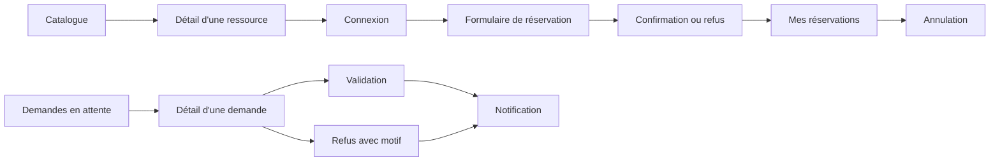

# Dossier d'analyse — L'Escale

| Date       | Changement                                                                                         |
| ---------- | -------------------------------------------------------------------------------------------------- |
| 12/10/2026 | Intégration des notes de l'entretien client (sections 6.1, 7, 7.2 et 12) ; compte rendu en attente |

## 1. Présentation du projet

L'Escale est un tiers-lieu associatif fictif qui met à disposition de ses
adhérents des ressources partagées : des salles de réunion, un studio
d'enregistrement, un véhicule utilitaire et du matériel empruntable.

Les réservations sont actuellement gérées par e-mail et dans un tableur
partagé. Ce fonctionnement entraîne des doubles réservations, une charge
importante pour l'équipe et un manque de traçabilité des utilisations.

Le projet consiste à développer une application web permettant aux adhérents de
consulter les ressources et d'effectuer leurs réservations, tout en appliquant
automatiquement les règles d'utilisation. L'équipe doit pouvoir administrer le
catalogue, traiter les demandes nécessitant une validation et consulter
l'activité.

## 2. Objectifs

Les objectifs principaux sont :

- éviter les doubles réservations ;
- permettre aux adhérents de vérifier eux-mêmes les disponibilités ;
- faire respecter automatiquement les règles de réservation ;
- réduire les demandes envoyées par e-mail à l'équipe ;
- conserver un historique des actions importantes ;
- proposer une interface utilisable sur ordinateur et téléphone ;
- protéger les données personnelles et les accès selon le rôle de l'utilisateur.

## 3. Périmètre

### 3.1 Fonctionnalités incluses

- authentification et déconnexion ;
- gestion des comptes par l'administrateur ;
- consultation et recherche du catalogue ;
- création, consultation et annulation de réservations ;
- validation ou refus des demandes par un gestionnaire ;
- gestion des ressources et des périodes de maintenance ;
- notifications dans l'application ;
- journal d'activité ;
- tableau de bord gestionnaire si le temps le permet.

### 3.2 Fonctionnalités hors périmètre

- paiement en ligne ;
- gestion des cotisations ;
- application mobile native ;
- gestion des clés et des badges ;
- inscription libre des adhérents ;
- création automatique des comptes adhérents par les utilisateurs.

Les notifications par e-mail et l'export iCalendar sont des fonctionnalités
souhaitables. Elles seront traitées uniquement après les exigences
indispensables et importantes.

## 4. Acteurs et droits

| Acteur         | Description                      | Droits principaux                                                                                                    |
| -------------- | -------------------------------- | -------------------------------------------------------------------------------------------------------------------- |
| Visiteur       | Personne non authentifiée        | Consulter et rechercher le catalogue                                                                                 |
| Adhérent       | Utilisateur inscrit par l'équipe | Réserver, consulter et annuler ses réservations ; consulter ses notifications et ses données                         |
| Gestionnaire   | Membre de l'équipe               | Droits de l'adhérent ; gérer les ressources et maintenances ; valider ou refuser les demandes ; consulter l'activité |
| Administrateur | Responsable de l'application     | Droits du gestionnaire ; créer les comptes ; attribuer ou retirer le rôle de gestionnaire ; désactiver un compte     |

Les contrôles d'accès doivent être effectués côté serveur. Le masquage d'un
bouton dans l'interface ne constitue pas une protection suffisante.

## 5. User stories prioritaires

### US-01 — Consulter le catalogue

**En tant que** visiteur ou utilisateur connecté,  
**je veux** consulter les ressources disponibles,  
**afin de** connaître leur description, leur catégorie et leurs conditions
d'utilisation.

**Priorité :** indispensable.

**Critères d'acceptation :**

- le catalogue est accessible sans authentification ;
- chaque ressource présente une description, une catégorie et ses conditions
  d'utilisation ;
- une photo peut être affichée lorsqu'elle existe ;
- une ressource retirée du catalogue n'est plus proposée comme réservable.

### US-02 — Rechercher une ressource

**En tant que** visiteur ou utilisateur connecté,  
**je veux** filtrer les ressources par catégorie, mot-clé et période,  
**afin de** trouver une ressource adaptée et disponible.

**Priorité :** indispensable.

**Critères d'acceptation :**

- la recherche accepte une catégorie ;
- la recherche accepte un mot-clé ;
- la recherche peut vérifier la disponibilité sur une période ;
- les résultats indiquent clairement lorsqu'aucune ressource ne correspond.

### US-03 — Se connecter

**En tant qu** utilisateur créé par l'équipe,  
**je veux** me connecter et me déconnecter,  
**afin de** bénéficier des fonctionnalités correspondant à mon rôle.

**Priorité :** indispensable.

**Critères d'acceptation :**

- aucune inscription libre n'est proposée ;
- des identifiants invalides sont refusés avec un message explicite ;
- un compte désactivé ne peut pas se connecter ;
- la déconnexion invalide la session.

### US-04 — Réserver une ressource

**En tant qu** adhérent,  
**je veux** demander une ressource sur un créneau,  
**afin de** l'utiliser pendant une période définie.

**Priorité :** indispensable.

**Critères d'acceptation :**

- seuls les utilisateurs autorisés peuvent réserver ;
- les dates et heures sont validées ;
- les règles métier sont contrôlées côté serveur ;
- un chevauchement avec une réservation existante est refusé ;
- deux demandes simultanées ne peuvent pas créer deux réservations
  incompatibles ;
- le système explique la raison d'un refus ;
- une ressource nécessitant une validation produit une demande en attente.

### US-05 — Consulter et annuler ses réservations

**En tant qu** adhérent,  
**je veux** consulter mes réservations à venir et passées et annuler une
réservation lorsque cela est autorisé,  
**afin de** gérer mes utilisations.

**Priorité :** indispensable.

**Critères d'acceptation :**

- un adhérent ne voit que ses propres réservations ;
- les réservations sont séparées entre à venir et passées ;
- l'annulation est refusée lorsque le délai de 24 heures est dépassé ;
- un gestionnaire peut annuler une réservation dans le cadre de ses droits ;
- l'utilisateur reçoit un retour clair après l'action.

### US-06 — Traiter une demande

**En tant que** gestionnaire,  
**je veux** valider ou refuser une demande en attente,  
**afin de** contrôler l'accès aux ressources concernées.

**Priorité :** indispensable.

**Critères d'acceptation :**

- seuls les gestionnaires et administrateurs peuvent traiter une demande ;
- une validation change le statut de la demande ;
- un refus exige un motif ;
- le motif du refus est visible par l'adhérent ;
- une demande non traitée avant le début du créneau est automatiquement
  annulée.

### US-07 — Gérer les ressources

**En tant que** gestionnaire,  
**je veux** créer, modifier, retirer une ressource et déclarer une maintenance,

**afin de** maintenir un catalogue fiable.

**Priorité :** indispensable.

**Critères d'acceptation :**

- seuls les gestionnaires et administrateurs peuvent modifier le catalogue ;
- une ressource peut être associée à une catégorie ;
- une période de maintenance empêche les réservations concernées ;
- les adhérents concernés sont prévenus lorsqu'une maintenance affecte une
  réservation existante.

### US-08 — Gérer les comptes

**En tant qu** administrateur,  
**je veux** créer, désactiver et gérer les rôles des comptes,  
**afin de** contrôler les accès à l'application.

**Priorité :** indispensable.

**Critères d'acceptation :**

- seuls les administrateurs peuvent gérer les comptes ;
- un administrateur peut créer un compte ;
- un administrateur peut attribuer ou retirer le rôle de gestionnaire ;
- un compte désactivé ne peut plus se connecter ;
- les réservations futures d'un compte désactivé sont annulées.

### US-09 — Recevoir des notifications

**En tant qu** utilisateur concerné par un événement,  
**je veux** recevoir une notification dans l'application,  
**afin de** connaître l'état de mes demandes et réservations.

**Priorité :** importante.

**Critères d'acceptation :**

- une notification est créée pour chaque événement prévu ;
- le nombre de notifications non lues est visible ;
- une notification peut être marquée comme lue ;
- un utilisateur ne voit que ses notifications.

### US-10 — Consulter le journal d'activité

**En tant que** gestionnaire,  
**je veux** consulter les actions importantes,  
**afin de** retrouver qui a fait quoi et quand.

**Priorité :** importante.

**Critères d'acceptation :**

- seuls les gestionnaires et administrateurs peuvent consulter le journal ;
- chaque entrée indique l'auteur, l'action, la cible et la date ;
- les entrées sont affichées dans l'ordre chronologique ;
- le journal est conservé pendant la durée définie par le client.

## 6. Règles métier identifiées

| Code | Règle                                                                                                                           |
| ---- | ------------------------------------------------------------------------------------------------------------------------------- |
| R1   | Un adhérent ne peut pas avoir plus de trois réservations à venir par catégorie. Les demandes en attente comptent dans le quota. |
| R2   | Une salle est réservée quatre heures maximum. Le matériel et le véhicule sont réservés trois jours maximum.                     |
| R3   | Une réservation ne peut pas commencer plus de trente jours après la demande.                                                    |
| R4   | Un adhérent peut annuler jusqu'à 24 heures avant le début. Au-delà, seul un gestionnaire peut annuler.                          |
| R5   | Une ressource en maintenance ne peut pas être réservée pendant la période concernée.                                            |
| R6   | Un refus doit comporter un motif visible par l'adhérent.                                                                        |
| R7   | Un compte désactivé ne peut plus se connecter et ses réservations futures sont annulées.                                        |
| R8   | Une demande non traitée avant le début du créneau est automatiquement annulée et l'adhérent est prévenu.                        |

Chaque règle devra être couverte par au moins un test automatisé.

### 6.1 Règles complémentaires issues de l'entretien (provisoires)

Ces règles proviennent des notes prises pendant l'entretien avec le client.
Elles restent provisoires jusqu'à la réception du compte rendu officiel. Elles
sont néanmoins **implémentées de façon provisoire** (constantes isolées dans
`lib/domain/reservation-rules.ts`) afin de présenter une application complète ;
à la réception du compte rendu, elles seront ajustées ou retirées sans réécriture.

| Code  | Règle provisoire                                                                                                                                                     | Source     | Statut      |
| ----- | -------------------------------------------------------------------------------------------------------------------------------------------------------------------- | ---------- | ----------- |
| RC-01 | Le tiers-lieu est ouvert du lundi au samedi de 8 h à 20 h et fermé le dimanche. Les réservations de matériel et de véhicule peuvent couvrir les heures de fermeture. | Q-04       | À confirmer |
| RC-02 | Les jours fériés ne sont pas gérés par l'application.                                                                                                                | Q-04       | À confirmer |
| RC-03 | Un temps de battement sépare deux réservations d'une même ressource ; sa durée dépend de la catégorie.                                                               | Q-01       | À préciser  |
| RC-04 | Une réservation ne se modifie pas : l'adhérent l'annule puis en crée une nouvelle.                                                                                   | Q-02       | À confirmer |
| RC-05 | Aucun motif n'est demandé à l'adhérent pour réserver.                                                                                                                | Q-03       | À confirmer |
| RC-06 | Une maintenance annule automatiquement les réservations concernées, qui sont conservées avec le statut annulé ; les adhérents sont notifiés du motif.                | Q-07       | À confirmer |
| RC-07 | Une maintenance ne peut pas être modifiée ; elle peut être annulée.                                                                                                  | Q-16       | À confirmer |
| RC-08 | Les catégories sont fixes : salle, studio, véhicule, matériel.                                                                                                       | Q-08, Q-09 | À confirmer |
| RC-09 | La validation par un gestionnaire dépend de la catégorie (studio et véhicule) et n'est pas configurable.                                                             | Q-18, B05  | À confirmer |
| RC-10 | Une ressource possède une seule photo.                                                                                                                               | Q-11       | À confirmer |
| RC-11 | Une ressource retirée est archivée et reste visible dans l'historique des réservations.                                                                              | Q-12, Q-13 | À confirmer |
| RC-12 | Chaque équipement est un objet unique identifié par son numéro de série (50 caractères alphanumériques au plus) ou, à défaut, par un code de 6 caractères généré.    | Q-19       | À confirmer |

## 7. Questions posées au client

Les réponses ci-dessous sont reformulées à partir des notes prises pendant
l'entretien. Le compte rendu officiel du client n'a pas encore été reçu : à sa
réception, chaque réponse sera comparée aux notes puis passée au statut
« Validée ». Les notes brutes sont conservées telles quelles en annexe
(section 12).

Statuts utilisés :

- **Répondue (notes)** : réponse obtenue en entretien, en attente du compte
  rendu ;
- **À préciser** : réponse partielle, ambiguë ou en contradiction avec un autre
  point ;
- **Couverte par les documents** : la réponse figure dans la fiche
  d'expression de besoin ou le cahier des charges ;
- **Ouverte** : question non posée ou non tranchée pendant l'entretien.

### Fonctionnement des réservations

| Référence | Question                                                                                                                                                                               | Réponse                                                                                                                                                                                                     | Statut           |
| --------- | -------------------------------------------------------------------------------------------------------------------------------------------------------------------------------------- | ----------------------------------------------------------------------------------------------------------------------------------------------------------------------------------------------------------- | ---------------- |
| Q-01      | Une réservation peut-elle se terminer exactement au moment où une autre commence ?                                                                                                     | Un temps de battement s'applique selon la catégorie. Les notes mentionnent 15 min, 30 min de remise en ordre et 1 h pour le véhicule, sans battement pour les autres. L'affectation exacte est à confirmer. | À préciser       |
| Q-02      | Une réservation confirmée peut-elle être modifiée ou doit-elle être annulée puis recréée ?                                                                                             | Pas de modification : l'adhérent annule puis recrée sa réservation.                                                                                                                                         | Répondue (notes) |
| Q-03      | Quelles informations l'adhérent doit-il fournir pour justifier une demande de réservation ?                                                                                            | Aucun motif. L'adhérent choisit la ressource et le créneau ; le demandeur, la date de la demande et le statut sont enregistrés automatiquement.                                                             | Répondue (notes) |
| Q-04      | Le tiers-lieu a-t-il des horaires d'ouverture spécifiques à respecter pour les réservations ?                                                                                          | Lundi au samedi de 8 h à 20 h, fermé le dimanche. Le matériel et le véhicule peuvent chevaucher les heures de fermeture. Les jours fériés ne sont pas gérés.                                                | Répondue (notes) |
| Q-05      | La limite de trois jours pour le matériel et le véhicule correspond-elle à des jours calendaires ou à 72 heures glissantes ?                                                           | Non tranché pendant l'entretien.                                                                                                                                                                            | Ouverte          |
| Q-06      | Le matériel peut-il être emprunté et rendu à n'importe quelle heure, ou des créneaux sont-ils imposés ?                                                                                | Non abordé.                                                                                                                                                                                                 | Ouverte          |
| Q-07      | Lorsqu'une maintenance concerne une ressource déjà réservée, faut-il annuler automatiquement les réservations à venir et notifier les adhérents, ou laisser le gestionnaire arbitrer ? | Annulation automatique. Les réservations sont conservées avec le statut annulé et les adhérents sont notifiés avec le motif « maintenance ».                                                                | Répondue (notes) |

### Ressources et maintenances

| Référence | Question                                                                                                                                        | Réponse                                                                                                                                                                                              | Statut                     |
| --------- | ----------------------------------------------------------------------------------------------------------------------------------------------- | ---------------------------------------------------------------------------------------------------------------------------------------------------------------------------------------------------- | -------------------------- |
| Q-08      | Quelles sont les catégories exactes de ressources à proposer au lancement ?                                                                     | Salle, studio, véhicule et matériel, comme indiqué dans les documents (règle R1).                                                                                                                    | Répondue (notes)           |
| Q-09      | Les catégories sont-elles fixes ou administrables par un administrateur ?                                                                       | Fixes : uniquement les quatre catégories prévues.                                                                                                                                                    | Répondue (notes)           |
| Q-10      | Quels champs sont obligatoires pour créer une ressource ?                                                                                       | Non tranché. Le besoin B01 cite la description, la photo, la catégorie et les conditions d'utilisation ; la capacité reste à confirmer.                                                              | Ouverte                    |
| Q-11      | Une ressource peut-elle posséder plusieurs images, et qui peut les gérer ?                                                                      | Une seule photo par ressource. Elle est gérée par les gestionnaires (EF-09).                                                                                                                         | Répondue (notes)           |
| Q-12      | Une ressource retirée du catalogue doit-elle être désactivée ou supprimée définitivement ?                                                      | Déduit de la réponse à Q-13 : la ressource est archivée, pas supprimée.                                                                                                                              | À préciser                 |
| Q-13      | Une ressource désactivée reste-t-elle visible dans les réservations passées ?                                                                   | Oui : la ressource est archivée pour rester visible dans l'historique.                                                                                                                               | Répondue (notes)           |
| Q-14      | Qui peut créer, modifier, retirer ou réactiver une ressource ?                                                                                  | Les gestionnaires et les administrateurs (FEB section 4, CDC section 3). La réactivation n'a pas été abordée.                                                                                        | Couverte par les documents |
| Q-15      | Quelles informations doivent être saisies pour déclarer une maintenance ?                                                                       | Aucune information à saisir : un bouton déclenche la maintenance, l'application affiche les réservations impactées, puis le gestionnaire confirme ou annule. À concilier avec R5 et EF-10 (période). | À préciser                 |
| Q-16      | Une maintenance peut-elle être modifiée ou supprimée après sa création ?                                                                        | Elle ne peut pas être modifiée, mais elle peut être annulée.                                                                                                                                         | Répondue (notes)           |
| Q-17      | Les maintenances récurrentes sont-elles nécessaires ou une période unique suffit-elle ?                                                         | Une période unique suffit. Les notes mentionnent aussi un « mode ON/OFF » : période datée ou simple état activé/désactivé, à clarifier.                                                              | À préciser                 |
| Q-18      | Le véhicule et le studio sont-ils les seules ressources soumises à validation, ou cette liste doit-elle être configurable par un gestionnaire ? | La validation dépend de la catégorie (studio et véhicule). La liste n'est pas configurable.                                                                                                          | Répondue (notes)           |
| Q-19      | Un équipement est-il géré comme un objet unique avec un numéro d'inventaire, ou faut-il gérer des quantités pour un même modèle ?               | Objet unique. Identifiant non auto-incrémenté : numéro de série s'il existe (50 caractères alphanumériques au plus), sinon code de 6 caractères généré par l'application.                            | Répondue (notes)           |

### Comptes, rôles et droits

| Référence | Question                                                                                                                        | Réponse                                                                                                                                                                                                                                                                  | Statut           |
| --------- | ------------------------------------------------------------------------------------------------------------------------------- | ------------------------------------------------------------------------------------------------------------------------------------------------------------------------------------------------------------------------------------------------------------------------ | ---------------- |
| Q-20      | Quels champs sont obligatoires à la création d'un compte et quelles règles s'appliquent au mot de passe ?                       | Nom, prénom et e-mail (identifiant de connexion). Le mot de passe est généré par l'application et remis par l'équipe. Les règles de complexité et le changement à la première connexion n'ont pas été abordés.                                                           | Répondue (notes) |
| Q-21      | Une adresse e-mail doit-elle être vérifiée avant de pouvoir réserver ?                                                          | Non tranché. La note renvoie à EF-14, qui concerne l'envoi des notifications par e-mail et non la vérification de l'adresse.                                                                                                                                             | Ouverte          |
| Q-22      | Qui peut créer, modifier, désactiver et réactiver un compte ?                                                                   | Non abordé.                                                                                                                                                                                                                                                              | Ouverte          |
| Q-23      | Un gestionnaire peut-il traiter toutes les ressources ou seulement un périmètre donné ?                                         | Non abordé.                                                                                                                                                                                                                                                              | Ouverte          |
| Q-24      | Que doit voir un visiteur non connecté lorsqu'il tente de réserver ?                                                            | Non abordé.                                                                                                                                                                                                                                                              | Ouverte          |
| Q-25      | Lorsqu'un adhérent demande la suppression de son compte, ses réservations à venir doivent-elles être annulées automatiquement ? | Réponse partielle : les entrées du journal dont l'adhérent est l'auteur sont anonymisées (droit à l'oubli) ; la suppression se demande par e-mail ou depuis l'espace personnel ; une inactivité d'un an est évoquée. Le sort des réservations à venir n'est pas tranché. | À préciser       |

### Notifications et suivi

| Référence | Question                                                                                                              | Réponse     | Statut  |
| --------- | --------------------------------------------------------------------------------------------------------------------- | ----------- | ------- |
| Q-26      | Quels événements doivent générer une notification ?                                                                   | Non abordé. | Ouverte |
| Q-27      | Les notifications sont-elles uniquement visibles dans l'application ou doivent-elles aussi être envoyées par e-mail ? | Non abordé. | Ouverte |
| Q-28      | Une notification doit-elle être marquée comme lue manuellement ou automatiquement à l'ouverture ?                     | Non abordé. | Ouverte |
| Q-29      | Combien de temps les notifications doivent-elles rester visibles ?                                                    | Non abordé. | Ouverte |
| Q-30      | Quelles actions doivent apparaître dans le journal d'activité ?                                                       | Non abordé. | Ouverte |
| Q-31      | Qui peut consulter le journal d'activité et quelles données personnelles doit-il masquer ?                            | Non abordé. | Ouverte |

### Interface, accessibilité et données personnelles

| Référence | Question                                                                                            | Réponse                                                                  | Statut           |
| --------- | --------------------------------------------------------------------------------------------------- | ------------------------------------------------------------------------ | ---------------- |
| Q-32      | Le fuseau horaire et le format des dates doivent-ils suivre le site ou le profil de l'utilisateur ? | Non abordé.                                                              | Ouverte          |
| Q-33      | Quelles tailles d'écran et quels navigateurs doivent être supportés en priorité ?                   | Toutes les tailles d'écran et tous les navigateurs, en « mobile first ». | Répondue (notes) |
| Q-34      | Quelles informations doivent être affichées dans le catalogue et dans le détail d'une ressource ?   | Non abordé.                                                              | Ouverte          |
| Q-35      | Les utilisateurs doivent-ils pouvoir rechercher par plusieurs critères simultanément ?              | Non abordé.                                                              | Ouverte          |

### Questions de conception des données

| Référence | Question                                                                                            | Réponse                                                                   | Statut           |
| --------- | --------------------------------------------------------------------------------------------------- | ------------------------------------------------------------------------- | ---------------- |
| MD-01     | Le rôle doit-il être une valeur contrôlée dans `User` ou une table dédiée ?                         | Proposition documentée dans l'ADR 005, validation client à confirmer      | Ouverte          |
| MD-02     | Les catégories de ressources sont-elles fixes ou administrables ?                                   | Fixes, voir Q-09 : une valeur contrôlée suffit.                           | Répondue (notes) |
| MD-03     | Une ressource retirée doit-elle être supprimée ou simplement désactivée ?                           | Archivée, voir Q-12 et Q-13.                                              | À préciser       |
| MD-04     | Les motifs de refus et de maintenance ont-ils une longueur ou un format particulier ?               | Non abordé. Q-15 suggère qu'aucun motif n'est saisi pour une maintenance. | Ouverte          |
| MD-05     | Les identifiants MongoDB doivent-ils stocker les identifiants PostgreSQL sous forme de UUID texte ? | À confirmer lors de l'implémentation                                      | Ouverte          |
| MD-06     | Quelle stratégie de concurrence doit être utilisée pour empêcher deux réservations simultanées ?    | Proposition documentée dans l'ADR 004, validation client à confirmer      | Ouverte          |

## 7.1. Grille de réponses supposées

Cette grille ne conserve que les questions encore ouvertes. Chaque proposition
est une hypothèse de travail : elle doit être confirmée, corrigée ou supprimée
avec le client. Une hypothèse ne devient pas une règle métier tant qu'elle n'a
pas été validée.

| Référence | Réponse supposée à valider                                                                               |
| --------- | -------------------------------------------------------------------------------------------------------- |
| Q-05      | La limite de trois jours correspond à 72 heures glissantes.                                              |
| Q-06      | Le retrait et le retour du matériel se font sur des créneaux définis.                                    |
| Q-10      | Le nom, la catégorie, la description, les conditions d'utilisation et la photo sont obligatoires.        |
| Q-21      | Aucune vérification d'e-mail : le compte est créé par l'équipe, qui remet le mot de passe.               |
| Q-22      | L'administrateur crée, modifie, désactive et réactive les comptes.                                       |
| Q-23      | Un gestionnaire peut traiter toutes les ressources, sans périmètre spécifique.                           |
| Q-24      | Un visiteur peut consulter le catalogue, mais doit se connecter pour réserver.                           |
| Q-25      | Les réservations à venir sont annulées avant la suppression effective du compte.                         |
| Q-26      | La création, la validation, le refus, l'annulation et la maintenance génèrent une notification.          |
| Q-27      | Les notifications sont visibles dans l'application ; l'e-mail est une évolution possible.                |
| Q-28      | L'utilisateur marque manuellement une notification comme lue.                                            |
| Q-29      | Les notifications restent visibles jusqu'à leur archivage ou leur suppression.                           |
| Q-30      | Les actions métier importantes sont journalisées, notamment les créations, décisions et annulations.     |
| Q-31      | Les gestionnaires et administrateurs consultent le journal ; les données sensibles y sont limitées.      |
| Q-32      | Le site utilise un fuseau horaire unique communiqué par le client.                                       |
| Q-34      | Le catalogue affiche les informations présentes dans les maquettes et la fiche détaillée.                |
| Q-35      | La recherche peut combiner texte, catégorie, date, capacité et disponibilité.                            |
| MD-01     | Le rôle est une valeur contrôlée dans `User`, conformément à l'ADR 005.                                  |
| MD-04     | Le motif de refus est obligatoire, avec une longueur maximale.                                           |
| MD-05     | Les identifiants PostgreSQL sont stockés sous forme de UUID texte dans MongoDB.                          |
| MD-06     | Une contrainte transactionnelle et une vérification de chevauchement empêchent les doubles réservations. |

## 7.2. Points à relancer auprès du client

Ces points sont ambigus ou contradictoires dans les notes d'entretien. Ils
seront vérifiés dans le compte rendu, puis reposés au client s'ils n'y sont
pas tranchés.

| Référence | Point à clarifier                                                                                                                                                                                               | Questions liées   |
| --------- | --------------------------------------------------------------------------------------------------------------------------------------------------------------------------------------------------------------- | ----------------- |
| RL-01     | Quelle durée de battement s'applique à quelle catégorie (15 min, 30 min, 1 h) ? Le matériel en est-il exempté ?                                                                                                 | Q-01              |
| RL-02     | Une maintenance est-elle une période datée (début et fin, comme l'indiquent R5 et EF-10) ou un simple état activé/désactivé ? Un motif est-il saisi ?                                                           | Q-15, Q-17, MD-04 |
| RL-03     | Quels champs sont obligatoires pour une ressource ? La capacité concerne-t-elle uniquement les salles et le studio ?                                                                                            | Q-10              |
| RL-04     | Une vérification de l'adresse e-mail est-elle utile, sachant que l'équipe crée le compte et remet le mot de passe ?                                                                                             | Q-21              |
| RL-05     | Qui crée les comptes et remet le mot de passe : l'administrateur seul (EF-02) ou aussi les gestionnaires ? Le changement de mot de passe est-il obligatoire à la première connexion ?                           | Q-20, Q-22        |
| RL-06     | À la suppression d'un compte, que deviennent les réservations à venir ? Un compte inactif depuis un an est-il désactivé ou supprimé ? Comment concilier l'anonymisation du journal et sa conservation d'un an ? | Q-25              |
| RL-07     | Les salles et le studio doivent-ils être réservés entièrement entre 8 h et 20 h ? Le matériel peut-il être retiré ou rendu le dimanche ?                                                                        | Q-04, Q-06        |

## 8. Hypothèses en attente de validation

Tant que le client n'a pas répondu, les hypothèses doivent être clairement
identifiées et ne doivent pas être présentées comme des décisions définitives.

| Référence | Hypothèse provisoire                                                                                                                                           | Justification                                                                                                  | Validation                                |
| --------- | -------------------------------------------------------------------------------------------------------------------------------------------------------------- | -------------------------------------------------------------------------------------------------------------- | ----------------------------------------- |
| H-01      | Les catégories principales sont salle, studio, véhicule et matériel.                                                                                           | Elles sont explicitement citées dans les deux documents.                                                       | Confirmée en entretien (Q-08), CR attendu |
| H-02      | Les notifications sont stockées dans MongoDB avec le journal d'activité.                                                                                       | Cette organisation est imposée par le cahier des charges.                                                      | Validée par la contrainte technique       |
| H-03      | Les réservations passées sont anonymisées lors de la suppression d'un compte.                                                                                  | Cette règle est explicitement indiquée dans l'expression de besoin.                                            | Validée par le besoin                     |
| H-04      | Le fuseau horaire utilisé sera celui communiqué par le client.                                                                                                 | Les documents ne donnent pas encore de fuseau explicite.                                                       | À confirmer                               |
| H-05      | Le studio se réserve 4 heures au maximum, comme une salle (R2).                                                                                                | R2 ne précise que les salles (4 h), le matériel et le véhicule (3 jours).                                      | À confirmer (question à poser)            |
| H-06      | Aucun temps de battement n'est appliqué entre deux réservations (RC-03).                                                                                       | Q-01 contient des durées contradictoires (RL-01) ; la valeur par catégorie est paramétrable (`bufferMinutes`). | En attente du compte rendu                |
| H-07      | Une maintenance est une période datée avec un motif, annulable mais non modifiable (RL-02, RC-07).                                                             | R5 et EF-10 parlent d'une « période ».                                                                         | À confirmer                               |
| H-08      | Les comptes sont créés par l'administrateur seul, sans changement de mot de passe obligatoire à la première connexion ni vérification d'e-mail (RL-04, RL-05). | Le CDC exclut l'inscription libre et ne prévoit pas de messagerie obligatoire.                                 | À confirmer                               |
| H-09      | À la suppression d'un compte, les réservations à venir sont annulées et les passées anonymisées ; le journal ne contient que des identifiants (RL-06).         | Besoin explicite d'anonymisation des réservations passées (section 7 de la FEB).                               | À confirmer                               |
| H-10      | Les salles et le studio se réservent du lundi au samedi, 8 h–20 h ; le matériel et le véhicule à toute heure, dimanche compris (RL-07).                        | Q-04 : le matériel et le véhicule peuvent chevaucher la fermeture.                                             | À confirmer                               |
| H-11      | Une ressource ne peut pas être retirée du catalogue tant qu'elle a des réservations à venir.                                                                   | Évite des réservations sur une ressource introuvable ; l'archivage conserve l'historique (RC-11).              | À confirmer                               |

## 9. Parcours principaux à maquetter

### Parcours A — Rechercher puis consulter une ressource

1. Le visiteur ouvre le catalogue.
2. Il sélectionne éventuellement une catégorie.
3. Il saisit un mot-clé ou une période.
4. L'application affiche les résultats.
5. Il ouvre la fiche détaillée d'une ressource.

### Parcours B — Réserver une ressource

1. L'adhérent se connecte.
2. Il recherche une ressource.
3. Il consulte les créneaux disponibles.
4. Il saisit le créneau demandé.
5. L'application valide les données et les règles métier.
6. La réservation est confirmée ou placée en attente de validation.

### Parcours C — Annuler une réservation

1. L'adhérent se connecte.
2. Il ouvre ses réservations à venir.
3. Il sélectionne une réservation.
4. Il demande son annulation.
5. L'application vérifie le délai autorisé.
6. La réservation est annulée ou le refus est expliqué.

### Parcours D — Traiter une demande

1. Le gestionnaire se connecte.
2. Il consulte les demandes en attente.
3. Il ouvre une demande.
4. Il la valide ou la refuse.
5. En cas de refus, il saisit un motif obligatoire.
6. L'adhérent reçoit une notification.

## 10. Maquettes

Les maquettes de l'application sont réalisées dans Figma. Elles couvrent les
écrans principaux du parcours adhérent et du parcours gestionnaire :

- la page de connexion ;
- le catalogue ;
- les filtres de recherche ;
- la fiche d'une ressource ;
- le formulaire de réservation ;
- la liste des réservations de l'adhérent ;
- la liste des demandes du gestionnaire ;
- le détail d'une demande ;
- la gestion d'une ressource ;
- la création d'une ressource ;
- la planification d'une maintenance ;
- les notifications ;
- les états de succès, d'erreur, de refus et d'annulation.

Les écrans sont déclinés en versions desktop et mobile.

### Fichier Figma

[Ouvrir les maquettes de L'Escale dans Figma](https://www.figma.com/design/wTAzP53wpG3XGt4rt62QZo/L-Escale?node-id=13-57444&t=ZLi6CL7zTMlqhcjY-1)

Le fichier Figma constitue la source de référence des écrans et de leur
organisation. Les maquettes sont réparties entre les pages suivantes :

- `00 - Fondations, parcours et états` ;
- `02 - Maquettes desktop` ;
- `03 - Maquettes mobile`.

### Enchaînement des écrans

Les parcours principaux sont organisés ainsi :

## 11. Points à compléter après échange avec le client

- comparer les réponses « Répondue (notes) » au compte rendu du client dès sa
  réception, puis les passer au statut « Validée » ;
- reposer au client les points de la section 7.2 qui ne sont pas tranchés par
  le compte rendu ;
- poser les questions restées « Ouvertes » ;
- transformer les règles RC-xx confirmées en règles de gestion testées ;
- transformer les hypothèses validées en décisions documentées ;
- ajuster les user stories si le client précise le besoin, en particulier
  US-07 (maintenance) une fois le point RL-02 tranché ;
- ~~mettre à jour les catégories des maquettes Figma : salle, studio, véhicule
  et matériel~~ — fait le 12 octobre 2026 ;
- ajouter des exports figés si nécessaire ;
- maintenir le lien Figma et le schéma d'enchaînement à jour ;
- dater la version du document et noter les changements importants.

## 12. Annexe — Notes brutes de l'entretien client

Notes prises pendant l'entretien, reproduites sans correction. Elles servent de
source aux réponses reformulées de la section 7 et seront comparées au compte
rendu officiel dès sa réception. Les questions absentes de cette liste n'ont
pas été tranchées pendant l'entretien.

| Référence | Note brute                                                                                                                                                                                                                            |
| --------- | ------------------------------------------------------------------------------------------------------------------------------------------------------------------------------------------------------------------------------------- |
| Q-01      | Deux créneaux peuvent se suivre sans intervalle. Le temps de battement entre 2 ressources selon la catégorie (15minutes!! -> 30 de remise en ordre, 1h véhicule; le reste pas besoin, durées fixes )                                  |
| Q-02      | L'adhérent doit annuler et recréer.                                                                                                                                                                                                   |
| Q-03      | pas de motif à donner. elements directs : ressource,créneau (3jours max véhicule, temps en heure) / indirects : qui fait la demande, date, statut                                                                                     |
| Q-04      | Les réservations sont limitées aux horaires d'ouverture du tiers-lieu = lundi au samedi 8/20h , fermé dimanche. Matériel et véhicule : peuvent chevaucher horaires de fermeture. jours fériés pas gérés (pas traités)                 |
| Q-07      | Automatiser l'annulation ( les réservations restent mais statut annulé ) et les bénéficiaires seront avertis pour motif de maintenance                                                                                                |
| Q-08      | Les catégories des documents et des maquettes sont proposées au lancement. ( marqué dans le cahier des charges ) ( salle, studio, véicule, matériel )                                                                                 |
| Q-09      | Non. que les 4 prévues                                                                                                                                                                                                                |
| Q-10      | Le nom, la catégorie, la description, la capacité, les conditions et l'image sont obligatoires. voir B01 pdf?                                                                                                                         |
| Q-11      | Qu'une photo                                                                                                                                                                                                                          |
| Q-13      | Une ressource est archivée pour conserver dans l'historique                                                                                                                                                                           |
| Q-14      | Les gestionnaires gèrent les ressources ; l'administrateur dispose de tous les droits. ( écrit dans les pdf )                                                                                                                         |
| Q-15      | pas dinfos, juste bouton, ( afficher liste des réservations impactées ) / annuler / confirmer                                                                                                                                         |
| Q-16      | modifiée non, annuler oui                                                                                                                                                                                                             |
| Q-17      | Une période unique suffit pour la première version. / un mode ON/OFF                                                                                                                                                                  |
| Q-18      | c'est soumis à la contrainte de la catégorie / Non.                                                                                                                                                                                   |
| Q-19      | Oui, identifiant unique: pas d'autoincrément, numéro de série si en a ( 50caractères alphanumérique ) / sinon l'app doit gérer numéro de série ( 6 caractères )                                                                       |
| Q-20      | Le compte contient au minimum un nom/prénom, un e-mail (servira d'identifiant de connexion) / et un mot de passe (généré par l'app et remis par le gestionnaire/admin)                                                                |
| Q-21      | voir cdc F14                                                                                                                                                                                                                          |
| Q-25      | que se passe t il a la suppresision d'un compte? anonymiser le journal d'activité si ça vient de l'utulisateur ( droit à l'oubli ), uniquement par mail ou via son dashboard / inactivité du compte ( log dernière connexion - 1 an ) |
| Q-33      | toute taille / tout nav -> mobile first                                                                                                                                                                                               |
