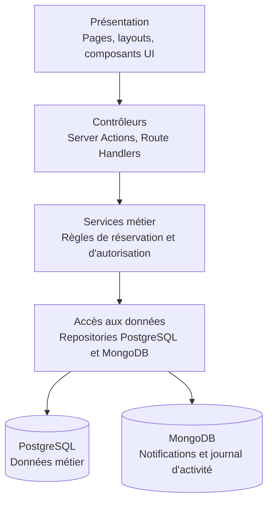

# Architecture de l'application L'Escale

## 1. Objectif

L'application L'Escale est organisée en couches afin de séparer la
présentation, le contrôle des requêtes, la logique métier et l'accès aux
données. Cette organisation facilite la maintenance, les tests et l'évolution
de l'application.

Chaque couche ne peut appeler que la couche située immédiatement en dessous.
Les composants de présentation ne doivent donc jamais accéder directement à une
base de données.

## 2. Vue d'ensemble



## 3. Présentation

La couche de présentation regroupe les éléments visibles et utilisables par
les utilisateurs :

- pages et layouts du dossier `app/` ;
- composants d'interface ;
- formulaires ;
- messages de succès et d'erreur ;
- affichage des ressources, réservations et notifications.

Cette couche collecte les actions de l'utilisateur et affiche les résultats.
Elle ne contient pas les règles métier centrales et n'interroge pas directement
les repositories.

## 4. Contrôleurs

Les contrôleurs sont implémentés avec les Server Actions et les Route Handlers
de Next.js.

Ils sont responsables de :

- vérifier l'authentification ;
- vérifier le rôle et les droits sur la ressource concernée ;
- valider les données reçues avec Zod ;
- appeler le service métier correspondant ;
- transformer le résultat en réponse exploitable par l'interface.

Les contrôleurs ne doivent pas contenir les règles métier complexes et ne
doivent pas interroger directement PostgreSQL ou MongoDB.

## 5. Services métier

Les services métier regroupent les règles fonctionnelles de l'application.
Ils doivent rester indépendants de Next.js afin d'être testés avec Vitest sans
démarrer l'application web.

Les services implémentés (`lib/services/`) sont :

| Service               | Responsabilité                                                                |
| --------------------- | ----------------------------------------------------------------------------- |
| `AuthService`         | Vérification des identifiants, état du compte (R7), relecture du rôle         |
| `ResourceService`     | Catalogue public, recherche par disponibilité, gestion du catalogue (EF-09)   |
| `ReservationService`  | Création, annulation, validation, refus motivé et expiration (R1 à R6, R8)    |
| `MaintenanceService`  | Périodes de maintenance et annulation des réservations concernées (R5, RC-06) |
| `UserService`         | Comptes et rôles (EF-02), désactivation (R7), données personnelles, RGPD      |
| `NotificationService` | Notifications dans l'application et compteur de non lues (EF-11)              |
| `ActivityService`     | Journal d'activité des actions importantes (EF-12)                            |
| `DashboardService`    | Indicateurs des gestionnaires (EF-13)                                         |
| `RateLimiter`         | Limitation des tentatives de connexion (OWASP A07)                            |

Chaque service vérifie lui-même les droits de la personne (`lib/domain/permissions.ts`)
et la propriété des données : le contrôleur ne suffit pas à protéger une action.

Le service de réservation applique notamment les règles R1 à R8 :

- quota par catégorie ;
- durée maximale ;
- délai de réservation ;
- délai d'annulation ;
- périodes de maintenance ;
- refus motivé ;
- désactivation d'un compte ;
- expiration automatique des demandes non traitées.

Les services reçoivent leurs dépendances, notamment les repositories, afin de
faciliter les tests et de limiter leur couplage aux détails techniques.

## 6. Accès aux données

Les repositories sont les seuls composants autorisés à interroger les bases de
données.

### PostgreSQL

PostgreSQL stocke les données métier :

- utilisateurs et rôles ;
- ressources ;
- réservations ;
- périodes de maintenance.

L'accès s'effectue avec Prisma (ADR 001). Les migrations (`prisma/migrations/`) et
le script de seed (`prisma/seed.ts`) sont versionnés. Les chevauchements de
réservations sont refusés par une contrainte d'exclusion PostgreSQL (ADR 004),
créée dans la migration `reservation_constraints`.

### MongoDB

MongoDB stocke les données transversales :

- notifications ;
- journal d'activité.

Les repositories MongoDB sont séparés des repositories PostgreSQL afin de
respecter les responsabilités de chaque base. Un index TTL supprime
automatiquement les entrées du journal après un an.

## 7. Règles de dépendance

Les dépendances autorisées sont :

```text
Présentation
    ↓
Contrôleurs
    ↓
Services métier
    ↓
Repositories
    ↓
Bases de données
```

Les dépendances suivantes sont interdites :

- un composant d'interface vers un repository ;
- un composant d'interface vers une base de données ;
- un service métier vers une API Next.js ;
- un contrôleur vers PostgreSQL ou MongoDB sans passer par un service ;
- un repository vers un composant de présentation.

Ces règles sont vérifiées par la règle ESLint `no-restricted-imports`
configurée dans `eslint.config.mjs`, exécutée par la CI. Les types et règles
pures de `lib/domain/` ainsi que les schémas de `lib/validations/` sont
partagés : ils n'importent aucune autre couche ni Next.js.

L'assemblage des services avec leurs repositories concrets est centralisé dans
`lib/services/index.ts`. Les services reçoivent leurs repositories par leur
constructeur, ce qui permet de les tester avec une implémentation en mémoire.

## 8. Sécurité et validation

Les contrôles de sécurité sont réalisés côté serveur :

- l'authentification est vérifiée avant toute action protégée ;
- les rôles sont vérifiés selon l'action demandée ;
- la propriété des réservations est vérifiée ;
- toutes les données entrantes sont validées avec Zod ;
- les mots de passe sont stockés sous forme de hash ;
- les secrets sont fournis par les variables d'environnement ;
- les erreurs ne doivent pas divulguer de données sensibles.

Le contrôle d'accès ne doit jamais dépendre uniquement de l'affichage ou du
masquage d'un bouton dans l'interface.

## 9. Éco-conception

Les choix suivants sont prévus pour limiter les ressources consommées :

- pagination des listes de ressources, réservations et journaux ;
- limitation de la taille et du poids des images ;
- chargement des données uniquement lorsque cela est nécessaire ;
- limitation du nombre de requêtes inutiles ;
- index adaptés aux recherches et aux contrôles de disponibilité ;
- absence de rafraîchissement automatique non justifié ;
- messages et interfaces simples afin de limiter le poids des pages.

Ces choix seront vérifiés et complétés au cours de l'implémentation.

## 10. Arborescence

```text
app/                       présentation : pages, layouts, Route Handlers (route.ts)
components/                composants d'interface réutilisables (formulaires, en-tête, cartes)
lib/
  controllers/             validation Zod, droits, appel des services, Server Actions
  services/                règles de gestion (indépendantes de Next.js)
  repositories/
    postgres/              repositories Prisma (client généré dans postgres/generated, non versionné)
    mongo/                 repositories MongoDB
    files/                 stockage des photos sur disque
  domain/                  types et règles pures (règles R1 à R8, droits, fuseau horaire)
  validations/             schémas Zod des données entrantes
prisma/
  schema.prisma
  migrations/
  seed.ts
proxy.ts                   Content Security Policy avec nonce (ADR 007)
tests/
  unit/                    Vitest, repositories en mémoire (tests/support)
  integration/             Vitest contre PostgreSQL et MongoDB réels
  e2e/                     Playwright : parcours, sécurité, accessibilité (axe-core)
scripts/                   démarrage Docker, sauvegarde et restauration
```

## 11. Éco-conception : état d'avancement

| Besoin                        | Réalisation                                                                    |
| ----------------------------- | ------------------------------------------------------------------------------ |
| Poids des pages et des images | Photos limitées à 2 Mo (JPEG, PNG, WebP) ; `next/image` pour les images fixes  |
| Nombre de requêtes            | Aucun rafraîchissement automatique ; une requête par page pour les listes      |
| Pagination                    | Journal d'activité paginé (25 entrées) ; notifications limitées à 50           |
| Index adaptés aux recherches  | Index PostgreSQL sur ressource/créneau, adhérent/statut, catégorie ; TTL Mongo |
| Mise en cache                 | Photos servies avec `Cache-Control` immuable (nom de fichier aléatoire)        |
| Rendu à la requête (ADR 007)  | Choix assumé : pas de prérendu, pages légères, aucun appel externe             |
