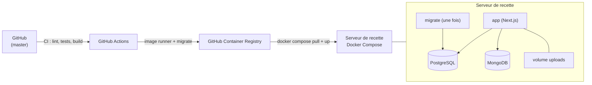

# Documentation de déploiement

Ce document permet à une personne qui n'a pas développé l'application de
l'installer, la lancer en local et la déployer en recette.

## 1. Architecture de déploiement



Plateforme d'hébergement proposée : **un serveur Linux unique avec Docker
Compose**, derrière un reverse proxy HTTPS (Caddy ou nginx). Ce choix est à
faire valider par le formateur (CDC, section 7.1).

## 2. Variables d'environnement

| Variable                                            | Obligatoire | Rôle                                                                     |
| --------------------------------------------------- | ----------- | ------------------------------------------------------------------------ |
| `DATABASE_URL`                                      | oui         | Connexion PostgreSQL                                                     |
| `MONGODB_URI`                                       | oui         | Connexion MongoDB (notifications, journal)                               |
| `AUTH_SECRET`                                       | oui         | Secret de signature des sessions (`openssl rand -base64 32`)             |
| `AUTH_URL`                                          | recette     | Adresse publique de l'application (HTTPS)                                |
| `CRON_SECRET`                                       | oui         | Secret de la tâche d'expiration des demandes (R8)                        |
| `UPLOAD_DIR`                                        | non         | Dossier des photos (`/data/uploads` dans l'image, volume `uploads_data`) |
| `SHOW_DEMO_ACCOUNTS`                                | non         | `true` affiche les comptes de démonstration sur la page de connexion     |
| `SEED_PASSWORD`                                     | non         | Mot de passe des comptes du jeu d'essai (jamais en production)           |
| `DATABASE_URL_TEST`, `MONGODB_URI_TEST`             | tests       | Bases dédiées aux tests d'intégration et de bout en bout                 |
| `POSTGRES_USER`, `POSTGRES_PASSWORD`, `POSTGRES_DB` | recette     | Compte et base PostgreSQL du Compose de recette                          |

Les valeurs de développement sont dans `.env.example` ; celles de la recette
dans `.env.recette.example`. **Aucun secret n'est versionné.**

## 3. Installation locale

Prérequis : Node.js 22, Docker Desktop, Git.

Une seule commande (application et bases) :

```bash
docker compose up --build
```

L'application démarre sur http://localhost:3000. Au premier lancement, le
conteneur génère le client Prisma, applique les migrations et charge le jeu
d'essai (sur une base vide seulement).

Sans conteneur pour l'application :

```bash
cp .env.example .env.local        # puis adapter AUTH_SECRET
docker compose up -d postgres mongodb
npm install
npm run db:generate && npm run db:migrate && npm run db:seed
npm run dev
```

Comptes de démonstration (`SHOW_DEMO_ACCOUNTS=true`) : `admin@lescale.test`,
`gestionnaire@lescale.test`, `camille.martin@lescale.test`,
`lucas.bernard@lescale.test`, `ines.garcia@lescale.test`. Mot de passe commun :
valeur de `SEED_PASSWORD` (voir `.env.example`).

## 4. Déploiement en recette

### 4.1 Préparation du serveur (une fois)

1. Installer Docker et le plugin Compose.
2. Copier sur le serveur, dans `~/lescale/` : `docker-compose.recette.yml` et un
   fichier `.env.recette` créé à partir de `.env.recette.example` (secrets
   générés, `APP_URL` en HTTPS).
3. Placer un reverse proxy HTTPS devant le port `APP_PORT`.
4. Dans GitHub : environnement `recette` et secrets `RECETTE_HOST`,
   `RECETTE_USER`, `RECETTE_SSH_KEY`.
5. Planifier la tâche d'expiration des demandes (R8), toutes les 5 minutes :

   ```bash
   */5 * * * * curl -fsS -X POST -H "Authorization: Bearer $CRON_SECRET" https://recette.exemple.fr/api/jobs/expire-requests
   ```

   (Les listes appliquent aussi l'expiration à chaque affichage : la tâche
   garantit que les adhérents sont prévenus même sans visite.)

### 4.2 Déploiement automatique

À chaque intégration sur `master`, le workflow `.github/workflows/deploy.yml` :

1. construit l'image `runner` et l'image `migrate`, étiquetées `master` et
   `sha-<commit>`, et les publie sur GHCR ;
2. se connecte en SSH au serveur de recette ;
3. exécute `docker compose pull`, puis `up -d` : le service `migrate` applique
   les migrations Prisma, puis l'application démarre (`depends_on:
service_completed_successfully`).

Sans les secrets `RECETTE_*`, seules les images sont publiées.

### 4.3 Déploiement manuel

```bash
docker compose -f docker-compose.recette.yml --env-file .env.recette up -d --build
```

## 5. Retour à la version précédente (rollback)

1. Repérer l'étiquette de la version saine dans GHCR (`sha-xxxxxxx`) ou dans
   l'historique des déploiements.
2. Lancer le workflow **Deploy (recette)** à la main (`workflow_dispatch`) avec
   cette étiquette, ou sur le serveur :

   ```bash
   export APP_IMAGE=ghcr.io/joordy18/projet-lescale:sha-xxxxxxx
   export MIGRATE_IMAGE=ghcr.io/joordy18/projet-lescale-migrate:sha-xxxxxxx
   docker compose -f docker-compose.recette.yml --env-file .env.recette up -d --no-build
   ```

3. Les migrations Prisma ne sont **pas** annulées automatiquement. Une
   migration destructive doit donc être précédée d'une sauvegarde (section 6) ;
   pour revenir en arrière sur les données, restaurer cette sauvegarde.
4. Vérifier : page de connexion accessible, connexion d'un compte de test,
   catalogue affiché.

## 6. Sauvegarde et restauration des bases

Scripts : `scripts/backup.sh` et `scripts/restore.sh` (PostgreSQL : `pg_dump` au
format custom ; MongoDB : `mongodump` en archive compressée).

```bash
# Sauvegarde (développement)
sh scripts/backup.sh

# Sauvegarde (recette)
COMPOSE="docker compose -f docker-compose.recette.yml --env-file .env.recette" \
  POSTGRES_USER=lescale POSTGRES_DB=lescale sh scripts/backup.sh

# Restauration : remplace le contenu des bases ciblées
sh scripts/restore.sh backups/postgres-AAAAMMJJ-HHMMSS.dump backups/mongodb-AAAAMMJJ-HHMMSS.archive.gz
```

Les photos téléversées sont dans le volume `uploads_data` : à sauvegarder
séparément (`docker run --rm -v <projet>_uploads_data:/data -v $PWD/backups:/b alpine tar czf /b/uploads.tgz -C /data .`).

**Test de restauration (12 octobre 2026)** : sauvegarde de la base de
développement, restauration dans des bases vierges (`lescale_restore`),
comparaison :

| Donnée                       | Source | Restaurée |
| ---------------------------- | ------ | --------- |
| Comptes                      | 5      | 5         |
| Ressources                   | 36     | 36        |
| Réservations                 | 7      | 7         |
| Notification de test MongoDB | 1      | 1         |

L'index TTL du journal (un an) est restauré avec la collection.

Fréquence recommandée en recette : quotidienne, conservation de 14 jours.

## 7. Exécution des tests

Voir le [plan de tests](../tests/plan-de-tests.md) pour le détail. Résumé :

| Niveau                      | Commande                                                   | Prérequis                                                     |
| --------------------------- | ---------------------------------------------------------- | ------------------------------------------------------------- |
| Lint, formatage, types      | `npm run lint && npm run format:check && npx tsc --noEmit` | —                                                             |
| Unitaires                   | `npm test`                                                 | —                                                             |
| Intégration                 | `npm run test:integration`                                 | `docker compose up -d postgres mongodb` + base `lescale_test` |
| Système / acceptation (e2e) | `npm run build && npm run test:e2e`                        | idem, `npx playwright install chromium`                       |

Dans la CI, les trois niveaux s'exécutent à chaque pull request ; les rapports
Playwright sont conservés 7 jours en cas d'échec.

## 8. Dépannage

| Symptôme                                                             | Cause probable et solution                                                                                                                                                                                                                    |
| -------------------------------------------------------------------- | --------------------------------------------------------------------------------------------------------------------------------------------------------------------------------------------------------------------------------------------- |
| Docker Desktop ne démarre pas (`… engine.sock … cannot be accessed`) | Fichier de socket périmé dans `%LOCALAPPDATA%\Docker\run` ou `docker-secrets-engine`, que Windows refuse de supprimer. Le supprimer depuis WSL : `wsl -d docker-desktop -e rm -f /mnt/host/c/Users/<nom>/AppData/Local/Docker/run/<fichier>`. |
| `npm ci` échoue dans Docker : `UNABLE_TO_VERIFY_LEAF_SIGNATURE`      | Un antivirus ou un proxy intercepte HTTPS : l'exclure pour Docker (ne pas désactiver la vérification TLS).                                                                                                                                    |
| `Cannot find native binding` au lancement de Vitest                  | Bug npm sur les dépendances optionnelles : supprimer `node_modules` et `package-lock.json`, puis `npm install`.                                                                                                                               |
| Port 3000 déjà utilisé                                               | Un autre conteneur `lescale-app` tourne : `docker compose stop app`.                                                                                                                                                                          |
| Formulaires inertes en production                                    | Page prérendue sans nonce CSP : voir l'ADR 007 (ne pas réactiver `cacheComponents`).                                                                                                                                                          |
